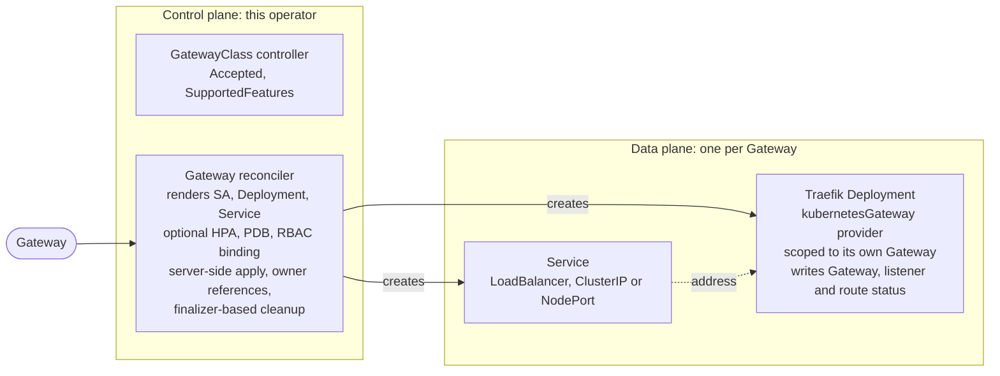

# Traefik Operator

A Kubernetes operator that provisions and manages dedicated [Traefik](https://github.com/traefik/traefik)
data planes for [Gateway API](https://gateway-api.sigs.k8s.io/) Gateways, following the
model popularized by Envoy Gateway: one `Gateway`, one data plane.

> Status: experimental. APIs (`gateway.traefik.io/v1alpha1`) may change without notice.

## Why

Traefik implements the Gateway API routing contract in-tree: a single, statically
deployed instance watches every `Gateway` in the cluster and routes all of them
through one shared data plane. That model is simple and cheap, but it cannot
satisfy the parts of the Gateway API that assume the implementation *provisions*
the data plane serving each Gateway:

- a correct, per-Gateway `status.addresses`,
- `GatewayStaticAddresses`: honoring user-requested `spec.addresses`,
- `GatewayInfrastructurePropagation`: propagating `spec.infrastructure` labels
  and annotations onto the generated resources,
- isolation: one tenant's Gateway saturating a shared instance affects everyone.

This operator closes that gap. For each `Gateway` it creates a dedicated Traefik
`Deployment`, `Service` and `ServiceAccount`, wires the instance to serve exactly
that Gateway, and lets Kubernetes garbage-collect everything when the Gateway is
deleted.

## What it is not

The operator does not reimplement routing. Provisioned Traefik instances run the
existing in-tree `kubernetesGateway` provider, scoped to their own Gateway: route
translation, listener validation and status reporting stay in Traefik, where they
are already implemented and conformance-tested. The operator owns infrastructure
provisioning and the `GatewayClass` status only.

## How it works



Single status writer per resource, no fights:

| Resource | Written by |
|---|---|
| `GatewayClass` status (Accepted, SupportedFeatures) | operator |
| `Gateway`, listener status (Accepted, Programmed, addresses, attachedRoutes) | data plane |
| Route and policy status (`HTTPRoute`, `TLSRoute`, `BackendTLSPolicy`...) | data plane |

## Features

- Per-Gateway data plane provisioning with owner-reference garbage collection.
- `spec.infrastructure.labels` and `annotations` propagated onto every generated
  resource, including Pods.
- Static addresses: `spec.addresses` rendered onto the data plane `Service`
  (`externalIPs`, `loadBalancerIP`), with `Programmed` gated on the address
  actually being realized.
- `LoadBalancer`, `ClusterIP` and `NodePort` Service types.
- Deployment modes: Gateway namespace (default), dedicated namespace, and merged
  Gateways (one shared data plane per GatewayClass).
- Optional `HorizontalPodAutoscaler` and `PodDisruptionBudget`.
- Log level, Prometheus metrics and OTLP tracing passthrough.
- Per-data-plane RBAC: each data plane ServiceAccount is bound to a shipped
  ClusterRole through an operator-managed ClusterRoleBinding.

## Requirements

- Kubernetes >= 1.31 (Gateway API v1.5 CRDs use CEL features absent from older
  API servers).
- [Gateway API v1.5.1](https://github.com/kubernetes-sigs/gateway-api/releases/tag/v1.5.1)
  CRDs (experimental channel for TLSRoute/TCPRoute support).
- A Traefik image carrying the `kubernetesGateway` provider options
  `gateway` and `disableGatewayClassStatus` (see
  [Data plane requirements](docs/configuration.md#data-plane-requirements)).

## Quick start

Install the CRDs and the operator:

```sh
kubectl apply -f config/crd
kubectl apply -f config/rbac
kubectl apply -f config/manager
```

Create a `GatewayClass`, its data plane configuration, and a first `Gateway`:

```yaml
apiVersion: gateway.networking.k8s.io/v1
kind: GatewayClass
metadata:
  name: traefik
spec:
  controllerName: traefik.io/gateway-controller
  parametersRef:
    group: gateway.traefik.io
    kind: TraefikProxy
    name: default
---
apiVersion: gateway.traefik.io/v1alpha1
kind: TraefikProxy
metadata:
  name: default
spec:
  deployment:
    replicas: 2
  service:
    type: LoadBalancer
---
apiVersion: gateway.networking.k8s.io/v1
kind: Gateway
metadata:
  name: my-gateway
  namespace: default
spec:
  gatewayClassName: traefik
  listeners:
  - name: http
    protocol: HTTP
    port: 80
```

Within seconds the operator provisions a Traefik Deployment and Service for
`my-gateway`, and the data plane reports the Gateway `Programmed` with the
address of its own Service. Attach `HTTPRoute`s as with any Gateway API
implementation.

See [Getting started](docs/getting-started.md) for a complete walkthrough and
[Configuration](docs/configuration.md) for the full `TraefikProxy` reference.

## Conformance

Validated against the Gateway API v1.5.1 conformance suite on kind with
MetalLB. GATEWAY-HTTP profile: core 33/33, extended 21/22, including
`GatewayStaticAddresses` and `GatewayInfrastructure`, which the static
single-instance model cannot support. The generated report lives in
[`conformance/reports`](conformance/reports); details and reproduction steps
in [Conformance](docs/conformance.md).

## Documentation

- [Getting started](docs/getting-started.md)
- [Configuration reference](docs/configuration.md)
- [Deployment modes](docs/deployment-modes.md)
- [Conformance](docs/conformance.md)
- [Design](docs/DESIGN.md)

## Development

```sh
make generate manifests   # regenerate deepcopy, CRD, RBAC
make build                # build the binary
make test                 # run unit tests
make run                  # run against the current kubeconfig
```
