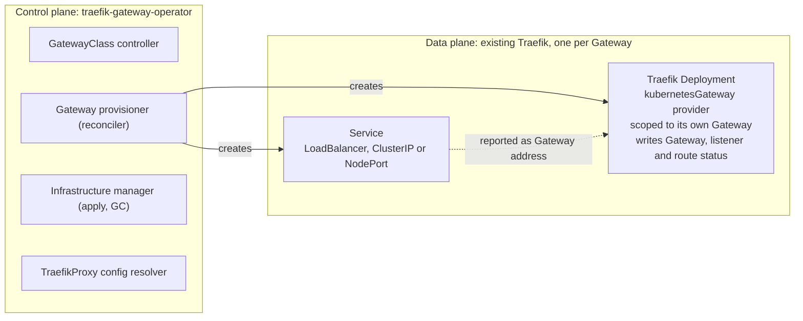
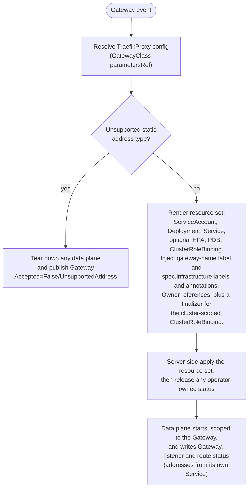

# Traefik Operator: Design

Status: implemented (phases 0 to 4), validated against the Gateway API v1.5.1
conformance suite. See the user documentation for current behavior; this
document records the design and its rationale.
Owners: @traefik/maintainers
Last updated: 2026-07-02

## 1. Motivation

Traefik already implements the Gateway API routing contract in
`pkg/provider/kubernetes/gateway` (Gateway, HTTPRoute, GRPCRoute, TLSRoute,
ReferenceGrant, BackendTLSPolicy translated into Traefik dynamic configuration).
That provider runs inside a single, statically deployed Traefik instance that
watches every Gateway in the cluster and routes all of them through one shared
data plane.

This static model passes the Gateway API conformance Core profiles and a large
share of Extended features, but it cannot satisfy the features that assume the
implementation provisions and owns a data plane per Gateway:

- `GatewayStaticAddresses`: honor user requested `spec.addresses` on the data
  plane that actually serves the Gateway.
- `GatewayInfrastructurePropagation`: propagate `spec.infrastructure.labels` and
  `spec.infrastructure.annotations` onto the resources generated for the Gateway.
- A semantically correct, per Gateway `status.addresses` (the static model can
  only report one shared address copied to every Gateway).

The current workaround is a provider level `statusAddress` option that copies a
single address into every Gateway status. It satisfies the letter of the
`GatewayAddressEmpty` test but is wrong as soon as Gateways are meant to carry
distinct addresses.

Envoy Gateway solves this by being an operator: it provisions a dedicated Envoy
data plane per Gateway and derives each Gateway status from the resources it
created. This document designs the equivalent for Traefik.

## 2. Goals and non goals

### Goals

1. Provision a Traefik data plane (Deployment or DaemonSet, Service,
   ServiceAccount) per Gateway.
2. Populate each Gateway `status.addresses` from the Service provisioned for
   that Gateway. The data plane does this through its `statusAddress.service`
   option; the operator does not.
3. Honor `spec.addresses` (static addresses) on the provisioned Service, and
   reject a Gateway that requests an unsupported address type before any data
   plane runs.
4. Propagate `spec.infrastructure.labels` and `spec.infrastructure.annotations`
   onto the generated resources.
5. Expose data plane configuration through a `TraefikProxy` CRD referenced from
   `GatewayClass.spec.parametersRef`, mirroring the `EnvoyProxy` model.
6. Provision the data plane in the Gateway's own namespace, with the Gateway as
   owner for garbage collection.

### Non goals

1. Reimplementing Gateway API routing translation. The provisioned Traefik
   instances keep using the existing `pkg/provider/kubernetes/gateway` provider
   to turn routes into dynamic configuration. The operator provisions and
   configures data planes, it does not route traffic.
2. Replacing the Traefik Helm chart for users who are happy with a single shared
   instance. The operator is an additional, opt in deployment model.
3. Mesh profile support.

## 3. Architecture overview

Two planes, clearly separated:



Status ownership is split so that each resource has a single writer:

- the operator writes the GatewayClass status (Accepted plus a SupportedFeatures
  set spanning the operator and the data plane),
- the provisioned data plane writes the Gateway, listener and route status it
  already computes, and reports the address of the Service the operator created
  for it (through the provider `statusAddress.service` option),
- the operator takes over the Gateway status only to reject a Gateway that
  requests an unsupported static address type, in which case no data plane runs
  to write it (see section 4.4).

## 4. Components

### 4.1 GatewayClass controller

- Watches `GatewayClass` with `spec.controllerName == traefik.io/gateway-controller`.
- Sets `Accepted` and publishes `SupportedFeatures`.
- Resolves `spec.parametersRef` to a `TraefikProxy` resource and validates it.
  Invalid or missing parameters set `Accepted=False` with reason
  `InvalidParameters`.

### 4.2 Gateway provisioner (core reconciler)

For each accepted Gateway, reconciles the desired data plane:

1. Compute the effective `TraefikProxy` config (GatewayClass default merged with
   any Gateway scoped override).
2. Compute the infrastructure resource set (see 4.3).
3. Apply (server side apply) the resource set with the Gateway as owner.
4. Trigger the status manager (see 4.4).

Triggers: Gateway create/update/delete, owned resource changes, referenced
`TraefikProxy` changes, and the provisioned Service status changes.

### 4.3 Infrastructure manager

Owns the generated resource set per Gateway:

- `ServiceAccount`
- `Deployment` (default) or `DaemonSet` (configurable via `TraefikProxy`)
- `Service` (type from `TraefikProxy`, default `LoadBalancer`)
- optional `ConfigMap` for static Traefik configuration
- optional `PodDisruptionBudget`, `HorizontalPodAutoscaler`

Naming: `traefik-<gateway-namespace>-<gateway-name>-<hash>` to stay within label
and DNS limits, mirroring Envoy Gateway. All resources carry:

- `gateway.networking.k8s.io/gateway-name: <gateway-name>` (required by the
  `GatewayInfrastructure` conformance test)
- `app.kubernetes.io/managed-by: traefik-gateway-operator`
- the Gateway `spec.infrastructure.labels` and `annotations`

Resources set `metadata.ownerReferences` to the Gateway so Kubernetes garbage
collects them when the Gateway is deleted. The only exception is the
cluster-scoped `ClusterRoleBinding`, which cannot be owned by a namespaced
Gateway and is reclaimed by a finalizer plus explicit cleanup (see 6).

### 4.4 Status ownership

The initial design placed a full status manager in the operator, mirroring
Envoy Gateway `UpdateGatewayStatusProgrammedCondition`. Conformance testing
showed that approach duplicates, and stubs, the rich per-listener status the
in-tree provider already computes (attached routes, resolved references,
supported kinds, conflicts). The design was revised: the data plane writes the
Gateway, listener and route status it already computes, including
`status.addresses` (from its `statusAddress.service` option pointed at the
Service the operator provisioned). The operator does not write the Gateway
status in the normal case.

The one case the operator takes over is a Gateway that requests an unsupported
static address type. This is a hard spec error decided from the Gateway alone:
the requested configuration can never be satisfied, so no data plane may run
with it. The operator therefore does not provision the data plane (and tears
down any previously provisioned one, keeping the finalizer), and — because no
data plane is left to write the status — publishes it itself:
`Accepted=False/UnsupportedAddress` and `Programmed=False/Invalid`.

That write is a server-side apply under the operator's field manager, carrying
those conditions and an empty `status.addresses` (an explicit empty list clears
any addresses the torn-down data plane left behind). Once the spec is corrected,
the operator provisions the data plane again and applies an empty status under
its field manager, releasing every field it owned so the data plane resumes
ownership of the Gateway status.

A requested static address is still rendered onto the Service as
`externalIPs`/`loadBalancerIP` (section 4.3). Whether it is actually realized,
and the resulting `Programmed`/`AddressNotUsable` gating, is left entirely to
the data plane's `statusAddress` handling — the operator does not duplicate it.

### 4.5 TraefikProxy config resolver

Resolves and merges configuration (section 5) used by the infrastructure manager
to render the data plane.

## 5. TraefikProxy CRD

Group: `gateway.traefik.io`, Version: `v1alpha1`, Kind: `TraefikProxy`.
Referenced from `GatewayClass.spec.parametersRef` (cluster default) and
optionally overridden per Gateway through an annotation or a future
`infrastructure.parametersRef` once the upstream API supports it.

Indicative schema (not exhaustive):

```yaml
apiVersion: gateway.traefik.io/v1alpha1
kind: TraefikProxy
metadata:
  name: default
spec:
  provider:
    kubernetes:
      # how the data plane Service is exposed
      envoyService:        # name kept generic, see open questions
        type: LoadBalancer # LoadBalancer | ClusterIP | NodePort
        annotations: {}
        loadBalancerClass: ""
      deployment:
        replicas: 2
        strategy: {}
        pod:
          annotations: {}
          labels: {}
          tolerations: []
          nodeSelector: {}
          affinity: {}
        container:
          image: traefik:v3.7
          resources: {}
          env: []
    # daemonset alternative
    # daemonSet: { ... }
  traefik:
    # passthrough of static Traefik configuration knobs the operator is
    # allowed to set (entrypoints, log level, metrics, etc.)
    entryPoints:
      web:      { address: ":8080" }
      websecure:{ address: ":8443" }
    logs:
      level: INFO
  telemetry: {}
```

The resolver merges the GatewayClass default `TraefikProxy` with any Gateway
scoped override (last wins, deep merge of maps and lists by key).

## 6. Deployment mode

The data plane is provisioned in the Gateway's own namespace. `ownerReferences`
work directly and Kubernetes garbage collects the namespaced resources on
Gateway deletion. This is what the `GatewayInfrastructure` conformance test
exercises (it lists ServiceAccounts, Pods, Services in the Gateway namespace and
checks the `gateway-name` label and propagated metadata).

The one resource that cannot carry an owner reference is the cluster-scoped
`ClusterRoleBinding` granting the data plane ServiceAccount its role: a
cluster-scoped object cannot be owned by a namespaced one. The operator tracks
each Gateway with a finalizer (`gateway.traefik.io/data-plane`) and deletes the
binding explicitly when the Gateway is deleted.

## 7. Reconciliation flow (per Gateway)



## 8. Relationship to the existing Traefik Gateway provider

The provisioned Traefik instances run the existing
`pkg/provider/kubernetes/gateway` provider to translate routes attached to their
Gateway into dynamic configuration. One provider option makes this work,
implemented in the in-tree provider:

1. `--providers.kubernetesGateway.gateway=<namespace>/<name>` scopes a data
   plane instance to the single Gateway it was provisioned for, instead of all
   Gateways in the cluster. Without this, every provisioned instance would try
   to serve every Gateway.

The data plane is given a `statusAddress.service` option pointing at the Service
the operator provisioned, so it reports that Service's address as the Gateway
`status.addresses` and writes the Gateway, listener and route status it
computes. The operator only takes over the Gateway status to reject an
unsupported static address type, when no data plane runs (section 4.4). The
operator does not duplicate routing logic, which keeps the routing conformance
surface (the bulk of the features) in one place.

## 9. Feature coverage matrix

| Capability                              | Static instance (today) | Operator (this design) |
|-----------------------------------------|--------------------------|------------------------|
| Core HTTP / GRPC / TLS routing          | yes                      | yes (delegated)        |
| Extended HTTPRoute features             | yes                      | yes (delegated)        |
| `GatewayAddressEmpty`                   | workaround (shared addr) | yes (per Gateway)      |
| `GatewayOptionalAddressValue`           | workaround (shared addr) | yes (per Gateway)      |
| `GatewayStaticAddresses`                | no                       | yes                    |
| `GatewayInfrastructurePropagation`      | no                       | yes                    |
| Per Gateway `status.addresses`          | no (shared)              | yes                    |
| `Programmed` gated on real data plane   | no                       | yes                    |

## 10. RBAC

The operator needs cluster scoped permissions to:

- get, list, watch: `gateways`, `gatewayclasses`, `httproutes`, `grpcroutes`,
  `tlsroutes`, `tcproutes`, `referencegrants`, `backendtlspolicies`,
  `traefikproxies`.
- update, patch: `gateways/status`, `gatewayclasses/status`.
- create, update, patch, delete: `deployments`, `daemonsets`, `services`,
  `serviceaccounts`, `configmaps`, and optionally `poddisruptionbudgets`,
  `horizontalpodautoscalers`, in the namespaces it provisions into.
- create, patch: `events`.

Provisioned data plane ServiceAccounts get the route read permissions the
existing Gateway provider already requires.

## 11. Phasing

1. Phase 0: repository scaffolding, `TraefikProxy` CRD, GatewayClass controller,
   Gateway provisioner in Gateway namespace mode, Deployment plus LoadBalancer
   Service, status.addresses from LB ingress, `Programmed` gating. Unlocks
   per Gateway addresses and `GatewayInfrastructurePropagation`.
2. Phase 1: `spec.addresses` static address support, NodePort and ClusterIP
   Service types. Unlocks `GatewayStaticAddresses`.
3. Phase 2: autoscaling, PDB, advanced `TraefikProxy` passthrough, metrics and
   tracing wiring.

## 12. Open questions

1. CRD naming and grouping: `TraefikProxy` in `gateway.traefik.io` versus reusing
   the existing `traefik.io` CRD group. Needs alignment with the Traefik CRD
   conventions.
2. Per Gateway config override mechanism before the upstream API exposes a field
   for it: annotation versus a Traefik specific policy attachment.
3. How much static Traefik configuration to expose through `TraefikProxy` versus
   keeping it minimal and opinionated.
4. Image and version pinning policy for the provisioned Traefik (operator pins a
   compatible Traefik version, or user selectable).
